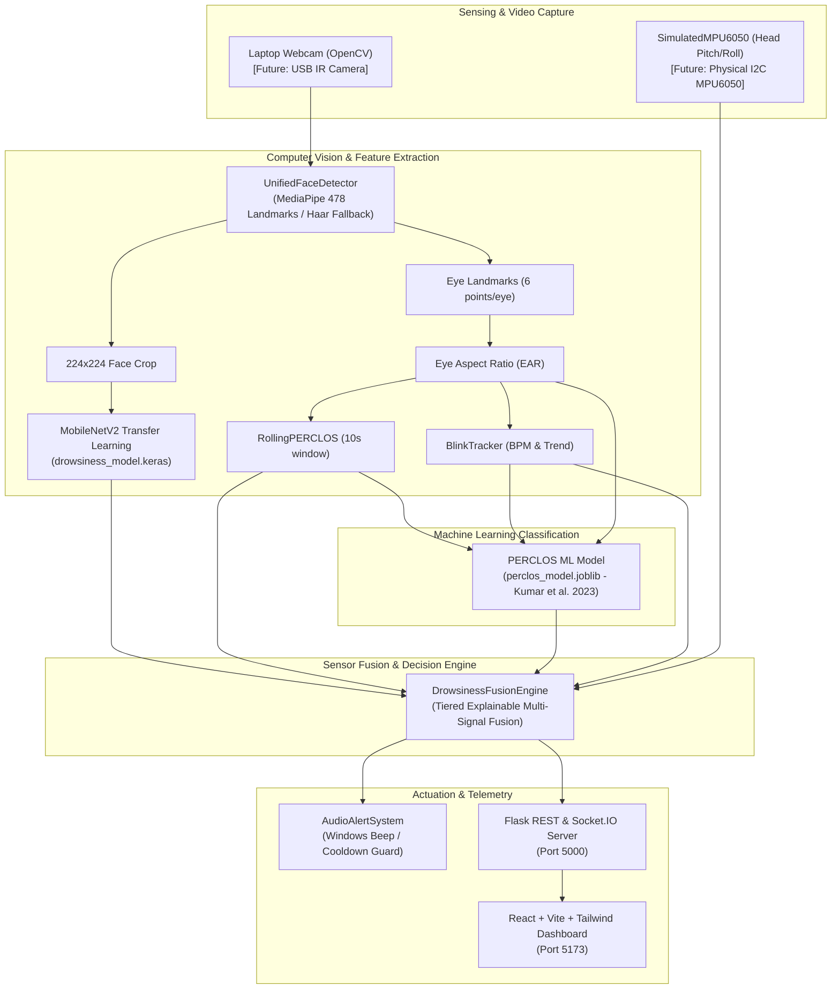
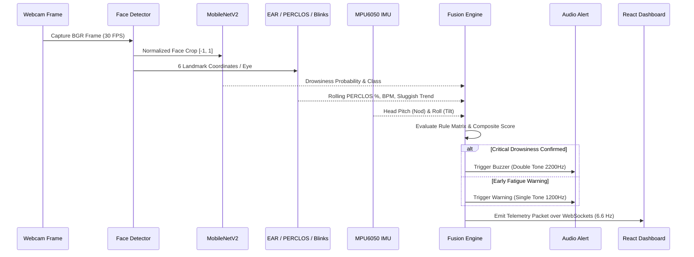

# AIoT Driver Drowsiness Detection: Technical Architecture

## 1. System Architecture Diagram

---

## 2. Data Flow Pipeline

---

## 3. Software vs. Future Hardware Interface Matrix

| Component | Current Software Prototype (Review Day) | Phase 2 Physical Hardware Integration | Software Adapter File |
| :--- | :--- | :--- | :--- |
| **Camera** | Built-in Laptop RGB Webcam | 850nm USB Infrared Camera with IR LEDs | `backend/inference/webcam.py` |
| **Motion Sensor** | `SimulatedMPU6050` (Normal, Nod, Tilt) | Physical MPU6050 on I2C bus (0x68) | `backend/sensors/real_mpu6050.py` |
| **Audio Buzzer** | Laptop Speaker (`winsound.Beep`) | 5V Piezo Buzzer on GPIO Transistor | `backend/alerts/audio_alert.py` |
| **Compute Board** | Windows 11 PC (Python 3.11) | Raspberry Pi 4 (4GB) or ESP32-S3 | `backend/config.py` |
| **Target Budget** | Zero additional hardware cost | **₹3,000 – ₹4,000** student budget | BOM in `docs/` |
